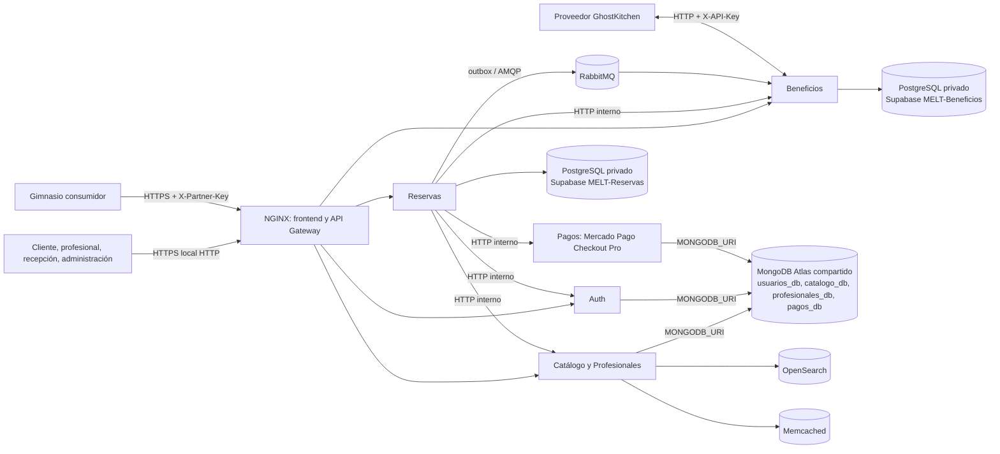
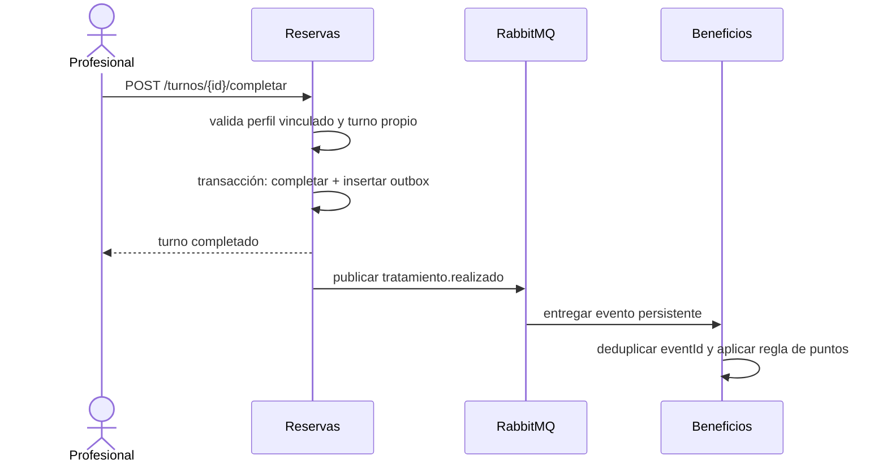

# Arquitectura vigente de MELT

Este documento resume la arquitectura del código y la configuración local. No certifica que los esquemas hayan sido aplicados ni que las conexiones Supabase estén configuradas en un entorno remoto.

## Contexto y componentes



## Responsabilidad y propiedad de datos

| Componente | Responsabilidad / datos principales | Persistencia y dependencias |
|---|---|---|
| Gateway (NGINX) | Frontend, routing, verificación de sesión para zonas privadas y propagación de identidad verificada a Reservas. | Sin base propia. En Compose deriva a servicios por DNS interno. |
| Auth | Cuentas, credenciales, roles, JWT e invitaciones asociadas al alta. | MongoDB Atlas compartido, base lógica `usuarios_db`. |
| Catálogo y Profesionales | Categorías, tratamientos, perfiles profesionales y vinculación `authUserId`. | MongoDB Atlas compartido, en bases lógicas separadas `catalogo_db` y `profesionales_db`; OpenSearch y Memcached son proyecciones/infra auxiliares. |
| Reservas | Agendas semanales, turnos, bloqueos, carritos, checkout y outbox. | PostgreSQL privado del proyecto Supabase `MELT-Reservas`; comunica con Auth, Catálogo, Pagos, Beneficios y RabbitMQ. |
| Pagos | Checkout Pro, verificación de pago y devoluciones en modo de prueba. | MongoDB Atlas compartido, base lógica `pagos_db`; endpoints internos con clave compartida. |
| Beneficios | Puntos, movimientos, reglas, recompensas, canjes, invitaciones externas y fallidos. | PostgreSQL privado del proyecto Supabase `MELT-Beneficios`; consume eventos RabbitMQ y consulta Auth. |
| Infraestructura | MongoDB Atlas compartido, PostgreSQL Supabase, RabbitMQ, OpenSearch, Memcached, Prometheus, Grafana y Jaeger. | No hay servidores MongoDB ni PostgreSQL de negocio locales en Compose. Reservas y Beneficios usan exclusivamente sus bases PostgreSQL privadas; todos los servicios Mongo se conectan a Atlas. |

Los servicios mantienen ownership separado y no consultan directamente tablas o colecciones ajenas. Reservas resuelve el perfil profesional a partir del ID autenticado consultando el endpoint interno de Catálogo; los IDs no se consideran equivalentes. La configuración de Supabase está en [infra/supabase](../infra/supabase/README.md); su aplicación y conectividad remotas se verifican por entorno.

## Comunicación

Las lecturas, validaciones y operaciones de negocio que necesitan respuesta inmediata usan HTTP síncrono. Las rutas internas de Auth, Catálogo y Pagos no se publican como APIs de navegador. El Gateway oculta con 404 prefijos internos seleccionados y enruta Catálogo, Auth, Reservas y Beneficios según `infra/nginx/default.conf`.

Para efectos posteriores, Reservas guarda cambios de turno y evento outbox en una transacción PostgreSQL. Un publicador entrega eventos persistentes al exchange topic `melt.dominio`; Beneficios consume `tratamiento.realizado` y `turno.cancelado`, aplica reintentos acotados y registra mensajes fallidos para reintento administrativo. No se debe describir una entrega exactamente-una-vez: el diseño permite reentrega y depende de deduplicación por `eventId`.

## Flujos de negocio

### Identidad y permisos

El registro público crea clientes. La creación de otras cuentas se hace con sesión administrativa; listar/modificar roles está reservado al superadministrador. Gateway verifica JWT en las rutas privadas de Reservas; Reservas vuelve a autorizar cada operación y aplica propiedad del turno/agenda. Beneficios valida nuevamente el Bearer. Catálogo valida administración contra Auth. Roles existentes: `cliente`, `profesional`, `recepcion`, `administrador` y `superadministrador`.

### Reserva, checkout y Mercado Pago en pruebas

1. El cliente consulta disponibilidad para un tratamiento, profesional y fecha.
2. Reservas valida asociación, agenda y conflictos, y crea bloqueo del carrito con vencimiento de diez minutos.
3. El carrito es propiedad del cliente autenticado; Reservas calcula importes usando Catálogo y descuentos asociados.
4. `POST /carrito/checkout` toma una clave idempotente, vuelve a validar los bloqueos y calcula total y seña del 30 % en el servidor.
5. Reservas solicita a Pagos una preferencia de Checkout Pro. Tras el retorno o un Webhook con firma válida, Pagos consulta el pago al proveedor y Reservas confirma el conjunto de turnos dentro de una transacción PostgreSQL. No se confirma parcialmente el checkout.

La regla de cancelación actual solicita a Mercado Pago la devolución de la seña si se cancela con al menos 24 horas; con menos anticipación no. Confirmar este detalle en las pruebas de demostración; no presentarlo como política externa/legal.

### Turno realizado y puntos

El profesional vinculado marca el turno como completado. Reservas guarda el cambio y el evento `tratamiento.realizado` en outbox; Beneficios procesa el evento con deduplicación. La inasistencia se registra como `no_asistio` y no emite evento de tratamiento realizado. Los puntos dependen de la regla administrativa del tratamiento; pagar o comprar no acredita automáticamente esos puntos.

## Persistencia, búsqueda y caché

- PostgreSQL protege agendas, turnos, bloqueos y checkout con transacciones; una restricción de exclusión impide turnos superpuestos por profesional y claves únicas protegen la idempotencia y los bloqueos por minuto.
- Beneficios usa transacciones PostgreSQL para actualizar saldo, movimientos y canjes sin duplicar solicitudes.
- Auth, Catálogo y Pagos conservan sus datos documentales en MongoDB.
- Catálogo consulta documentos canónicos en MongoDB. OpenSearch proporciona búsqueda textual/filtros y puede reconstruir el índice desde la fuente canónica; no sustituye la persistencia.
- Memcached se usa para lecturas cacheables de Catálogo con namespace configurable e invalidación por generación. Si falla, el servicio opera sin usar la caché cuando el camino de fallback funciona; la condición exacta está descrita en [manual del servicio](servicios/CATALOGO-PROFESIONALES.md).
- Los scripts de esquema son [beneficios.sql](../infra/supabase/beneficios.sql) y [reservas.sql](../infra/supabase/reservas.sql). El backend verifica las tablas al iniciar; la conectividad a los proyectos Supabase del equipo debe confirmarse con sus URLs privadas por entorno.

## Ejecución y evidencia

La configuración reproducible está en [compose.yaml](../compose.yaml), los comandos en [OPERACIONES.md](OPERACIONES.md), las limitaciones en la sección siguiente y la evidencia por requisito en [MATRIZ-CUMPLIMIENTO.md](MATRIZ-CUMPLIMIENTO.md). El repositorio conserva ensayos históricos fechados; su commit de ejecución no necesariamente coincide con el commit actual.

## Observabilidad, resiliencia y capacidad

- Todos los servicios emiten logs JSON con `request_id` y `trace_id`, exponen `/metrics` a Prometheus por la red interna y exportan trazas a Jaeger. La traza del flujo principal cruza Gateway, Reservas, Catálogo, Pagos y, a través del outbox y RabbitMQ, Beneficios. Tableros **MELT · Observabilidad S2** (Catálogo y réplicas) y **MELT · Flujo principal**. Ver [OBSERVABILITY.md](OBSERVABILITY.md) y [ADR-011](adr/ADR-011-observabilidad.md).
- Catálogo corre con dos réplicas detrás del Gateway, con detección pasiva y reintento de lecturas ([ADR-012](adr/ADR-012-balanceo-carga.md)). El comportamiento ante la caída de cada dependencia está en el [POSTMORTEM](POSTMORTEM.md).
- Consistencia y concurrencia de reservas, checkout, puntos y canjes: [ADR-004](adr/ADR-004-consistencia-concurrencia.md).
- Capacidad medida, límite principal y costos: [ADR-013](adr/ADR-013-capacidad-costos.md).

## Limitaciones conocidas y deuda técnica aceptada

| Limitación | Por qué se acepta | Qué haría falta |
|---|---|---|
| La mensajería entrega *al menos una vez*. | Es el modelo de RabbitMQ; Beneficios deduplica por `eventId` y está probado. | Nada mientras se mantenga la deduplicación en todo consumidor nuevo. |
| Los puntos pueden llegar con demora si RabbitMQ cae (outbox). | Completar un turno no debe depender del broker. Medido: 8,5 s para 10 eventos tras volver el broker. | Alertar al cliente si la demora supera un umbral. |
| Detección de réplica caída pasiva (NGINX OSS no tiene health checks activos). | Una sola solicitud por caída tarda 0,5 s; ninguna falla. | NGINX Plus, Envoy o un orquestador con health checks. |
| Jaeger guarda trazas en memoria; no hay Alertmanager. | Suficiente para la defensa y el entorno académico. | Almacenamiento persistente de trazas y envío de notificaciones. |
| La capacidad se midió en un host local compartido de 4 vCPU. | Permite ubicar el cuello (CPU de Catálogo) y comparar con y sin caché. | Repetir en hosts dedicados antes de dimensionar producción. |
| Auth, Catálogo y Pagos comparten un clúster MongoDB (bases lógicas separadas). | Costo cero en el plan académico; el ownership se respeta por base y no hay consultas cruzadas. | Clústeres separados si un servicio necesita aislar carga o fallas. |
| Mercado Pago opera sólo con credenciales de prueba. | El enunciado no exige cobros reales. | Credenciales productivas y revisión de seguridad. |
| Las credenciales de desarrollo de Compose no son aptas para producción. | Entorno local; los secretos reales viven en Render y no en el repositorio. | Gestor de secretos. |
| Consumo del proveedor externo (D9) y contrato publicado para el grupo consumidor (D8). | En curso en la parte A1–A3 del equipo. | Ver [GHOSTKITCHEN.md](GHOSTKITCHEN.md) e [INTEGRACION-GIMNASIO.md](INTEGRACION-GIMNASIO.md) al cerrarse. |

## Diagramas de secuencia

### Checkout agrupado

```mermaid
sequenceDiagram
  actor Cliente
  participant G as NGINX Gateway
  participant R as Reservas
  participant C as Catálogo
  participant P as Pagos / Mercado Pago
  Cliente->>G: GET /carrito (Bearer)
  G->>R: identidad verificada
  R->>C: precio, duración y asociaciones
  R-->>G: items y resumen
  Cliente->>G: POST /carrito/checkout (idempotencyKey)
  G->>R: checkout autenticado
  R->>R: validar bloqueos y recalcular importes
  R->>P: Crear preferencia Checkout Pro (clave interna)
  P-->>R: URL de pago en entorno de prueba
  R-->>Cliente: Redirigir a Checkout Pro
  Cliente->>P: Volver con payment_id
  Cliente->>R: POST /carrito/checkout/retorno
  R->>P: Consultar estado al proveedor
  P-->>R: estado, importe y referencia verificados
  alt pago aprobado y confirmación completa
    R->>R: confirmar todos los turnos en transacción
  else rechazo o conflicto
    R->>R: no confirmar turnos; compensar pago si aplica
  end
  R-->>Cliente: resultado idempotente
```

### Finalización y puntos


