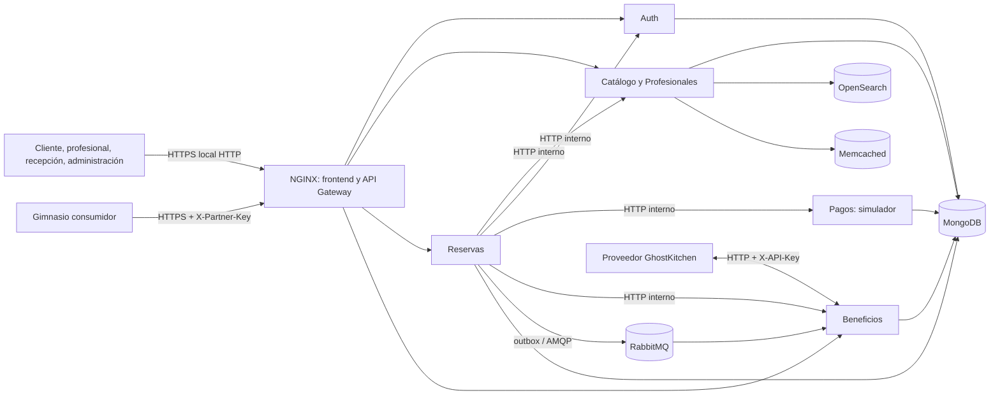
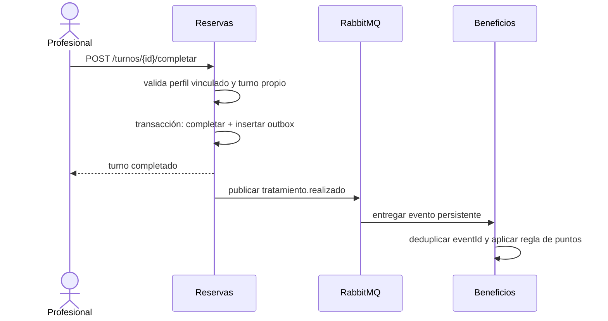

# Arquitectura vigente de MELT

**Base documental:** rama `develop`, commit de referencia `ea1ead7e85f533ba54aff85bd95958bb749897a0`. Este documento describe el código y la configuración versionados en esa referencia. No certifica el estado de un despliegue remoto.

## Contexto y componentes



## Responsabilidad y propiedad de datos

| Componente | Responsabilidad / datos principales | Persistencia y dependencias |
|---|---|---|
| Gateway (NGINX) | Frontend, routing, verificación de sesión para zonas privadas y propagación de identidad verificada a Reservas. | Sin base propia. En Compose deriva a servicios por DNS interno. |
| Auth | Cuentas, credenciales, roles, JWT e invitaciones asociadas al alta. | MongoDB `usuarios_db` por defecto. |
| Catálogo y Profesionales | Categorías, tratamientos, perfiles profesionales y vinculación `authUserId`. | MongoDB `catalogo_db` por defecto; OpenSearch y Memcached son proyecciones/infra auxiliares. |
| Reservas | Agendas semanales, turnos, bloqueos, carritos, checkout y outbox. | MongoDB `reservas_db`; comunica con Auth, Catálogo, Pagos, Beneficios y RabbitMQ. |
| Pagos | Operaciones de pago, reversas y devoluciones **simuladas**. | MongoDB `pagos_db`; endpoints internos con clave compartida. |
| Beneficios | Puntos, movimientos, reglas, recompensas, canjes, invitaciones externas y fallidos. | MongoDB `beneficios_db`; consume eventos RabbitMQ y consulta Auth. |
| Infraestructura | MongoDB replica set, RabbitMQ, OpenSearch, Memcached, Prometheus, Grafana y Jaeger. | Declarada en Compose. PostgreSQL también está declarado, pero no hay conexión desde los servicios de negocio del commit de referencia. |

Los servicios usan bases separadas dentro del clúster MongoDB; compartir el servidor no implica compartir propiedad de colecciones. Reservas resuelve el perfil profesional a partir del ID autenticado consultando el endpoint interno de Catálogo; los IDs no se consideran equivalentes.

## Comunicación

Las lecturas, validaciones y operaciones de negocio que necesitan respuesta inmediata usan HTTP síncrono. Las rutas internas de Auth, Catálogo y Pagos no se publican como APIs de navegador. El Gateway oculta con 404 prefijos internos seleccionados y enruta Catálogo, Auth, Reservas y Beneficios según `infra/nginx/default.conf`.

Para efectos posteriores, Reservas guarda cambios de turno y evento outbox en una transacción MongoDB. Un publicador entrega eventos persistentes al exchange topic `melt.dominio`; Beneficios consume `tratamiento.realizado` y `turno.cancelado`, aplica reintentos acotados y registra mensajes fallidos para reintento administrativo. No se debe describir una entrega exactamente-una-vez: el diseño permite reentrega y depende de deduplicación por `eventId`.

## Flujos de negocio

### Identidad y permisos

El registro público crea clientes. La creación de otras cuentas se hace con sesión administrativa; listar/modificar roles está reservado al superadministrador. Gateway verifica JWT en las rutas privadas de Reservas; Reservas vuelve a autorizar cada operación y aplica propiedad del turno/agenda. Beneficios valida nuevamente el Bearer. Catálogo valida administración contra Auth. Roles existentes: `cliente`, `profesional`, `recepcion`, `administrador` y `superadministrador`.

### Reserva, checkout y pago simulado

1. El cliente consulta disponibilidad para un tratamiento, profesional y fecha.
2. Reservas valida asociación, agenda y conflictos, y crea bloqueo del carrito con vencimiento de diez minutos.
3. El carrito es propiedad del cliente autenticado; Reservas calcula importes usando Catálogo y descuentos asociados.
4. `POST /carrito/checkout` toma una clave idempotente, vuelve a validar los bloqueos y calcula total y seña del 30 % en el servidor.
5. Reservas solicita el pago simulado a Pagos. Si se aprueba, confirma el conjunto de turnos; si falla la confirmación posterior, pide reversa simulada. No se confirma parcialmente el checkout.

La regla de cancelación actual en código reembolsa simuladamente la seña si se cancela con al menos 24 horas; con menos anticipación no. Confirmar este detalle en las pruebas de demostración; no presentarlo como política externa/legal.

### Turno realizado y puntos

El profesional vinculado marca el turno como completado. Reservas guarda el cambio y el evento `tratamiento.realizado` en outbox; Beneficios procesa el evento con deduplicación. La inasistencia se registra como `no_asistio` y no emite evento de tratamiento realizado. Los puntos dependen de la regla administrativa del tratamiento; pagar o comprar no acredita automáticamente esos puntos.

## Persistencia, búsqueda y caché

- MongoDB replica set soporta las transacciones multi-documento utilizadas por Reservas y otros flujos.
- Catálogo consulta documentos canónicos en MongoDB. OpenSearch proporciona búsqueda textual/filtros y puede reconstruir el índice desde la fuente canónica; no sustituye la persistencia.
- Memcached se usa para lecturas cacheables de Catálogo con namespace configurable e invalidación por generación. Si falla, el servicio opera sin usar la caché cuando el camino de fallback funciona; la condición exacta está descrita en [manual del servicio](servicios/CATALOGO-PROFESIONALES.md).
- PostgreSQL está en Compose, pero no se documenta como requisito funcional mientras no exista consumidor de negocio.

## Ejecución y evidencia

La configuración reproducible está en [compose.yaml](../compose.yaml), los comandos en [OPERACIONES.md](OPERACIONES.md) y las limitaciones/evidencia en [MATRIZ-CUMPLIMIENTO.md](MATRIZ-CUMPLIMIENTO.md). El repositorio conserva ensayos históricos fechados; su commit de ejecución no necesariamente coincide con el commit actual.

## Diagramas de secuencia

### Checkout agrupado

```mermaid
sequenceDiagram
  actor Cliente
  participant G as NGINX Gateway
  participant R as Reservas
  participant C as Catálogo
  participant P as Pagos simulados
  Cliente->>G: GET /carrito (Bearer)
  G->>R: identidad verificada
  R->>C: precio, duración y asociaciones
  R-->>G: items y resumen
  Cliente->>G: POST /carrito/checkout (idempotencyKey)
  G->>R: checkout autenticado
  R->>R: validar bloqueos y recalcular importes
  R->>P: POST /payments/simulate (clave interna)
  P-->>R: approved / rejected
  alt aprobado y confirmación completa
    R->>R: confirmar todos los turnos en transacción
  else rechazo o conflicto
    R->>R: no confirmar turnos; compensar pago si aplica
  end
  R-->>Cliente: resultado idempotente
```

### Finalización y puntos


