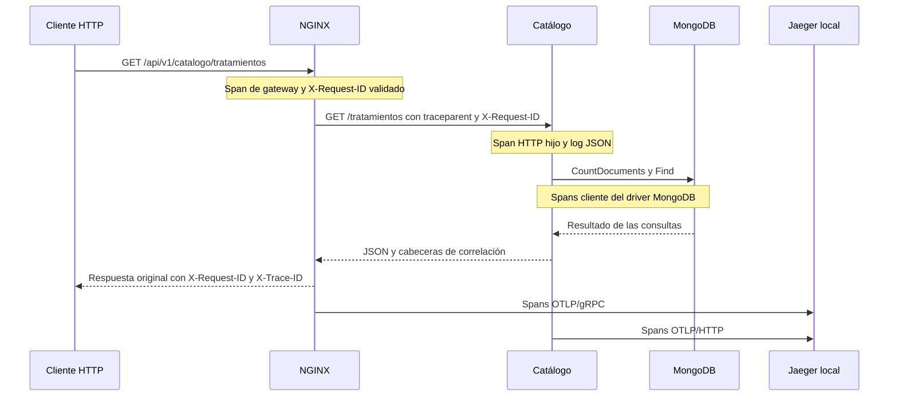

# MELT — Observabilidad D11

**Responsable:** Sofía.  
**Rama:** `feature/sofia-entrega-2`.  
**Base:** `0096f25`.  
**Alcance:** logs estructurados y correlacionados y primera traza del recorrido HTTP del Catálogo para la Entrega 2 del 23/10/2026.

## 1. Componentes instrumentados

El recorrido instrumentado es:



NGINX utiliza su módulo nativo OpenTelemetry; Catálogo utiliza el SDK OpenTelemetry de Go, middleware HTTP e instrumentación del driver MongoDB v2. Jaeger 2 recibe, almacena en memoria y permite consultar los spans. No se agrega un Collector separado: el receptor OTLP de Jaeger es suficiente para esta primera implementación local.

Una traza real relaciona spans con `trace_id`, `span_id` y referencias padre/hijo. `request_id` sirve para correlacionar logs y no reemplaza esa traza.

El cliente inicia las solicitudes y puede proporcionar un contexto W3C, pero no exporta un span propio. MongoDB no tiene instrumentación interna del servidor: los spans de base de datos miden comandos reales desde el driver de Catálogo, incluyendo espera de la respuesta. No se presentan como spans internos de ejecución del servidor MongoDB.

## 2. Iniciar D11

Requisitos: Docker Desktop operativo, servicios base de MELT iniciados y MongoDB saludable. Desde la raíz del repositorio:

```powershell
docker compose config --quiet
docker compose up -d jaeger
docker compose up -d --build --no-deps catalogo-profesionales
docker compose up -d --no-deps gateway
docker compose ps
```

El orden inicia el receptor antes de reiniciar las aplicaciones afectadas. Se mantienen las dos réplicas declaradas de Catálogo. Los comandos no eliminan volúmenes ni recrean MongoDB. Para un entorno nuevo, primero deben estar disponibles MongoDB, Reservas y Beneficios según la configuración base existente.

El gateway usa `nginx:1.28-alpine-otel`, en la misma familia 1.28 que la imagen anterior, con el módulo cargado mediante `infra/nginx/nginx.conf`. Jaeger usa `cr.jaegertracing.io/jaegertracing/jaeger:2.11.0` y `infra/jaeger/config.yaml`.

Catálogo exporta a `OTEL_EXPORTER_OTLP_TRACES_ENDPOINT=http://jaeger:4318/v1/traces`. Sin esa variable, el servicio puede ejecutarse sin exportador local. Los fallos de exportación no forman parte de las transacciones del negocio y se registran mediante un evento seguro, sin volcar la URL del exportador.

El cierre normal de Catálogo intenta drenar las solicitudes HTTP y vaciar el exportador con tiempos acotados. No se garantiza entrega de telemetría ante una terminación forzada o pérdida del receptor.

## 3. Logs JSON y correlación

```powershell
docker compose logs --no-color --tail 30 gateway catalogo-profesionales
```

Los accesos HTTP de NGINX y Catálogo incluyen:

| Campo | Significado |
| :--- | :--- |
| `timestamp` | Instante del registro en formato ISO/RFC 3339. |
| `level` | INFO para respuestas normales, WARN para 4xx y ERROR para 5xx. |
| `service` | `melt-gateway` o `catalogo-profesionales`. |
| `method`, `route`, `status` | Método, ruta normalizada y estado HTTP. |
| `duration_ms` | Duración del procesamiento de Catálogo en milisegundos. |
| `duration_seconds` | Duración observada por NGINX en segundos. |
| `request_id` | Identificador compartido entre gateway y Catálogo. |
| `trace_id`, `span_id` | Identificadores del span de ese componente. El `trace_id` coincide; los `span_id` son distintos. |
| `instance` | Contenedor de Catálogo que atendió la solicitud. |
| `upstream` | Instancia destino observada por NGINX. |

Un `X-Request-ID` es válido si tiene entre 1 y 64 caracteres ASCII, empieza por una letra o dígito y el resto contiene únicamente letras, dígitos, guiones o guiones bajos. Se conserva si es válido; en otro caso se genera un identificador. No se utiliza como credencial ni como autorización.

El gateway devuelve `X-Request-ID` y `X-Trace-ID` y propaga el identificador a Catálogo. Para evitar cabeceras duplicadas, devuelve su propia copia de estas cabeceras. Si Catálogo se consulta directamente, aplica la misma validación y devuelve sus propios identificadores.

Los errores de MongoDB se registran con operación e identificadores de correlación, sin copiar mensajes crudos que puedan contener valores de consulta. Los panics se convierten en el mismo estado HTTP 500 que el middleware anterior, pero sin volcar cabeceras, cuerpo ni valor del panic. Esto no corrige el test preexistente que acepta un 500 al comprobar la existencia de una ruta.

NGINX conserva diagnósticos internos de arranque/error en su formato nativo: los registros JSON aquí descritos son los accesos HTTP. Catálogo registra sus accesos y eventos de aplicación con `slog` JSON.

## 4. Generar y visualizar una traza

En PowerShell se utiliza `curl.exe` para evitar el alias de otros comandos:

```powershell
curl.exe -i -H "X-Request-ID: sofia-d11-demo" http://localhost:8080/api/v1/catalogo/tratamientos
curl.exe -i http://localhost:8080/api/v1/catalogo/tratamientos
curl.exe -i -H "X-Request-ID: id invalido" http://localhost:8080/api/v1/catalogo/tratamientos
```

1. Copiar el `X-Trace-ID` devuelto.
2. Abrir `http://localhost:16686/trace/EL_TRACE_ID` o buscar en Jaeger por servicio `melt-gateway` o `catalogo-profesionales`.
3. Esperar unos segundos por la exportación en lotes.
4. Comprobar un span de NGINX, un span HTTP hijo de Catálogo y los spans cliente de MongoDB, por ejemplo `tratamientos.aggregate` y `tratamientos.find` en el listado.
5. Buscar el mismo `request_id` en los logs de gateway y Catálogo. El `trace_id` debe coincidir con la traza consultada.

El endpoint público probado conserva el prefijo real `/api/v1/catalogo/`. La discrepancia anterior con el OpenAPI no se corrige como parte de D11.

## 5. Verificación automática

Compilación y tests de Catálogo:

```powershell
Push-Location services/catalogo-profesionales
go test -mod=readonly -count=1 -v ./...
go vet -mod=readonly ./...
go build -mod=readonly -o "$env:TEMP\melt-sofia-d11-catalogo.exe" ./cmd/api
Pop-Location
```

Los tests añadidos verifican validación de IDs, logs JSON, propagación de un padre remoto W3C, manejo seguro de panics y la relación padre/hijo del monitor MongoDB. Los tests de monitor son locales y no escriben en una base real.

Verificación del sistema en ejecución:

```powershell
python -X utf8 scripts/verify-observability.py
```

El script realiza GET y consultas de solo lectura a Docker y Jaeger. Verifica IDs suministrados, generados e inválidos; propagación W3C; logs coincidentes; spans de los dos servicios con relaciones padre/hijo; operaciones reales `aggregate` y `find`; dos réplicas saludables y ausencia de un marcador de prueba sensible en la telemetría registrada.

Opcionalmente, `--output ruta.json` guarda evidencia saneada con fecha, rama, commit base, logs y relaciones de spans. El archivo indica que la implementación tiene cambios sin commit. Las trazas en memoria pueden desaparecer; una evidencia guardada no garantiza que la URL de Jaeger siga disponible después de reiniciarlo.

## 6. Privacidad y límites

- Catálogo no registra cuerpos, consultas, Authorization, cookies, URI de MongoDB ni valores de panic. Las rutas usan plantillas, no identificadores de tratamientos o clientes.
- La instrumentación MongoDB deshabilita el atributo de comando y reemplaza el texto de errores del servidor por un estado genérico.
- El módulo NGINX agrega URL y user agent por defecto. El procesador de privacidad de Jaeger elimina `http.target`, `http.user_agent`, dirección del cliente y posibles textos de consultas antes de almacenarlos. Esos atributos viajan al receptor local, pero no quedan expuestos en su almacenamiento/UI. No se debe enviar información sensible en URLs.
- La UI solo se publica en `127.0.0.1:16686`; OTLP queda en la red interna de Compose. No hay autenticación de la UI: esta configuración es exclusivamente local.
- Jaeger conserva hasta 10 000 trazas en memoria, sin persistencia. El muestreo es completo en el gateway para esta demostración; Catálogo sigue la decisión del padre. No es una política de producción.
- Se prueba el recorrido de consulta del Catálogo. Reservas, Beneficios, frontend, eventos asíncronos y un cliente con span exportado quedan fuera de esta implementación.
- Prometheus y Grafana no se modifican: métricas, tableros, alertas y SLO siguen pendientes. D11 inicial y la evidencia de logs/traza no equivalen a completar toda la observabilidad del sistema final.

## 7. Evidencia de ejecución

Ejecución real del 23/10/2026 sobre los servicios reconstruidos desde `feature/sofia-entrega-2`, base `0096f25` y cambios de D11 todavía sin commit. Resultado guardado: [evidencia D11](evidence/d11-2026-10-23.json).

| Comprobación | Resultado observado |
| :--- | :--- |
| Compilación de Go en Windows e imagen Linux | APROBADO. |
| Tests existentes y cuatro tests nuevos | APROBADO. Se mantiene sin corregir el test preexistente de ruta por ID que admite un 500. |
| `go vet` | APROBADO. |
| ID válido, ausente e inválido | APROBADO: conservación o generación según corresponda. |
| Contexto W3C externo | APROBADO: mismo trace ID y padre remoto preservado en NGINX. |
| Logs JSON correlacionados | APROBADO: un acceso de gateway y otro de Catálogo por solicitud, con mismo request ID y trace ID. |
| Consulta real de trazas | APROBADO: span de NGINX, HTTP hijo y spans cliente de MongoDB `aggregate` y `find`. |
| Privacidad de telemetría registrada | APROBADO para el marcador de prueba en query y Authorization. |
| Dos réplicas y MongoDB | APROBADO: las dos réplicas responden salud OK. |
| Error de validación real | APROBADO: `limit=0` conserva HTTP 400 y genera logs JSON WARN correlacionados. |

Ejemplo real:

- Request ID: `sofia-d11-40b682c36947`.
- Trace ID: `5bbab6dab3e06927b6e9d0352f5af69b`.
- Consulta local: `http://localhost:16686/trace/5bbab6dab3e06927b6e9d0352f5af69b`.

La evidencia JSON contiene los identificadores de cada span, sus padres, los logs completos saneados y hashes de los archivos ejecutados. Una nueva ejecución generará otros identificadores. La evidencia guardada conserva el resultado aunque la traza deje de estar en memoria tras un reinicio.

No se hicieron escrituras de datos ni pruebas de caída de MongoDB. Los fallos y panics de los tests de observabilidad son locales/simulados; no prueban resiliencia productiva ni sustituyen el postmortem.
